# AVENTRA Production Architecture Blueprint

## 1. Architectural Boundary: Control Plane vs. Data Plane

```mermaid
flowchart TB
    subgraph VendorControlPlane["Vendor Licensing & Entitlement Control Plane (Optional / Offline)"]
        VendorCA["Vendor Root Trust Authority"] --> LicenseGen["License Entitlement Signer\n(Ed25519 / HMAC)"]
        LicenseGen --> LicenseToken["Signed License Token\n(aventra.lic / JSON)"]
    end

    subgraph CustomerVPC["Enterprise Customer Owned Data Plane (VPC / On-Prem)"]
        subgraph IngressSecurity["Security & Access Gateway"]
            OfflineVerifier["Offline License Verifier\n(Embedded Vendor Trust Root)"]
            JWTGateway["RBAC & JWT Auth Gateway"]
        end

        subgraph CoreServices["AVENTRA Core Services"]
            Agent["Enterprise AI Agent"]
            Engine["Workflow Execution Engine\n(DAG Synthesizer)"]
            ApprovalService["Approval Governance Service\n(Cryptographic Nonce)"]
            MemoryService["Persistent Enterprise Memory\n(Learned Mappings & Feedback)"]
            Ledger["SHA-256 Chained\nAudit Ledger"]
        end

        subgraph MLRegistry["Modular ML Layer (M1 - M8)"]
            M1["M1: Entity Resolution"]
            M2["M2: Schema Mapper"]
            M3["M3: Intent Parser"]
            M4["M4: Workflow Planner"]
            M5["M5: Invoice Reconciliation"]
            M6["M6: Adaptation Recommender"]
            M7["M7: Document Intelligence"]
            M8["M8: Anomaly Detection"]
        end

        subgraph EnterpriseConnectors["Enterprise Connector Bus (Least Privilege)"]
            CRMConn["CRM Connector (Salesforce / HubSpot)"]
            ERPConn["ERP Connector (SAP / ERPNext)"]
            DBConn["Database Connector (PostgreSQL / SQLite)"]
            EmailConn["Email Connector (Gmail API OAuth 2.0)"]
        end

        subgraph StorageLayer["Customer Owned Data Storage"]
            PostgresDB[("Enterprise PostgreSQL DB\n(WAL Enabled)")]
            LedgerDB[("Tamper-Evident Ledger Store")]
        end
    end

    LicenseToken -.->|Air-Gapped Ingestion| OfflineVerifier
    OfflineVerifier --> CoreServices
    JWTGateway --> CoreServices
    CoreServices <--> MLRegistry
    CoreServices <--> EnterpriseConnectors
    CoreServices --> StorageLayer

    style VendorControlPlane fill:#111723,stroke:#EF4444,stroke-width:2px
    style CustomerVPC fill:#06080D,stroke:#00E5FF,stroke-width:2px
```

### Data Sovereignty Guarantees
1. **Zero Data Egress**: Enterprise records, business documents, prompts, workflow histories, and vector embeddings NEVER leave the enterprise VPC.
2. **Offline Licensing**: Licensing validation happens 100% locally via cryptographic signature verification against an embedded vendor trust key. No outbound calls or phone-home beacons are mandated.
3. **Immutability**: All human approvals, autonomous tool actions, and model predictions are cryptographically chained in a local SHA-256 audit ledger.

---

## 2. Supported Deployment Targets

| Deployment Mode | Environment Target | Infrastructure Spec | Networking |
| :--- | :--- | :--- | :--- |
| **Target 1: Self-Hosted Appliance** | Single Enterprise VM / Bare Metal | Docker Compose, PostgreSQL 15, FastAPI, Next.js 14 | Local private subnet, TLS termination at reverse proxy |
| **Target 2: Enterprise Kubernetes** | Customer Cloud VPC (AWS EKS, GCP GKE, Azure AKS) | Helm Chart, StatefulSet for PostgreSQL, horizontal pod autoscalers | VPC-internal service mesh, NetworkPolicies blocking internet egress |
| **Target 3: Air-Gapped Secure Enclave** | Defense / Financial On-Prem Datacenter | Container images loaded via tarballs, local SQLite/PostgreSQL | 100% offline, zero internet gateway |

---

## 3. Initial Integration Scope & Standard Connector Matrix

| System Domain | Target Adapters | Protocol / Auth | Read Scope | Write Scope (Approval Required) |
| :--- | :--- | :--- | :--- | :--- |
| **CRM** | Salesforce, HubSpot, Generic CRM | OAuth 2.0 / REST API / API Key | Accounts, Contacts, Leads | Link Canonical Master ID, create verified Account |
| **ERP** | SAP S/4HANA, ERPNext, Generic ERP | REST API / OData / Basic Auth | Vendors, POs, Invoices, Goods Receipts | Link Master Vendor ID, post Approved Reconciliation |
| **Database** | PostgreSQL, SQLite | Parameterized SQL / Connection Pool | Schema introspect, parameterized `SELECT` | Controlled parameterized `INSERT`/`UPDATE` via tools |
| **Email** | Google Workspace (Gmail API) | OAuth 2.0 PKCE with granular scopes | Read authorized message threads, search | Create draft emails (Sending requires human approval) |

---

## 4. Per-Enterprise Configuration & Policy Boundaries

Each enterprise deployment configures an immutable `SecurityPolicyConfig`:
- **Approval Risk Threshold**: $\ge 0.85$ matching confidence or schema drift score mandates compliance sign-off.
- **Financial Tolerance Threshold**: Discrepancies $>2.0\%$ between PO, Invoice, and Goods Receipt block automated payment.
- **Prohibited Tool Invocations**: Direct SQL DDL operations (`DROP`, `ALTER`, `TRUNCATE`) are strictly blocked by the tool allowlist.
- **Credential Protection**: Connector secrets are injected via environment secrets or HashiCorp Vault; plain-text credentials are never returned over REST APIs or rendered in client UI bundles.

